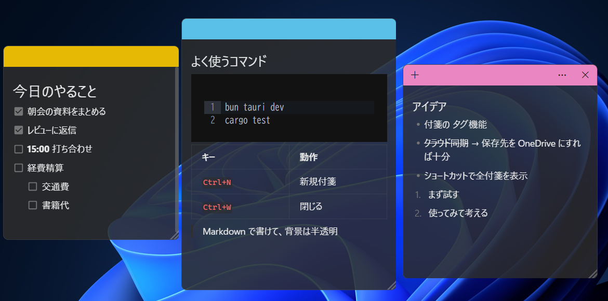

# md-sticky

Markdown で書ける、背景が半透明のデスクトップ付箋アプリ（Tauri 2 + Milkdown）。



## 特徴

- 背景が半透明
- 常に最前面
- WYSIWYG 風の Markdown 編集
- 全文検索可能
- 自動保存
- 常駐

## 操作

| 操作 | 方法 |
|---|---|
| 移動 | ヘッダーをドラッグ |
| リサイズ | 右下のグリップをドラッグ |
| 新規 | ＋ / `Ctrl+N` / 一覧の ＋ / トレイメニュー |
| 閉じる（隠す） | × / `Ctrl+W`（一覧から開き直せる） |
| 色・不透明度 | … メニュー |
| 一覧・検索 | … →「メモの一覧」/ トレイアイコンを左クリック |
| 削除 | … →「メモの削除」を 2 回押す / 一覧のゴミ箱を 2 回押す |
| 設定 | … →「設定」/ 一覧の歯車 / トレイメニュー |

## インストール

[Releases](https://github.com/Namacha411/md-sticky/releases/latest) から次のどちらかをダウンロードして実行する（Windows 10/11 x64）。

- `md-sticky_x.y.z_x64-setup.exe` … 通常はこちら（ユーザー単位でインストール、管理者権限不要）
- `md-sticky_x.y.z_x64_en-US.msi` … MSI が必要な場合

コード署名をしていないため、初回は SmartScreen の警告が出る。「詳細情報」→「実行」で進める。

## 保存先

`%APPDATA%\com.thdyk.md-sticky\`

- `notes/{id}.md` … 本文（素の Markdown）
- `notes.json` … 位置・サイズ・色・不透明度・最前面設定
- `settings.json` … フォント・文字サイズ・新規付箋の既定値（自動起動はレジストリに登録）

## 開発

```sh
bun install
bun tauri dev      # 開発起動
bun tauri build    # インストーラー作成
cd src-tauri && cargo test
```

## ライセンス

[MIT](LICENSE-MIT) または [Apache-2.0](LICENSE-APACHE) のいずれかを選択できます。
